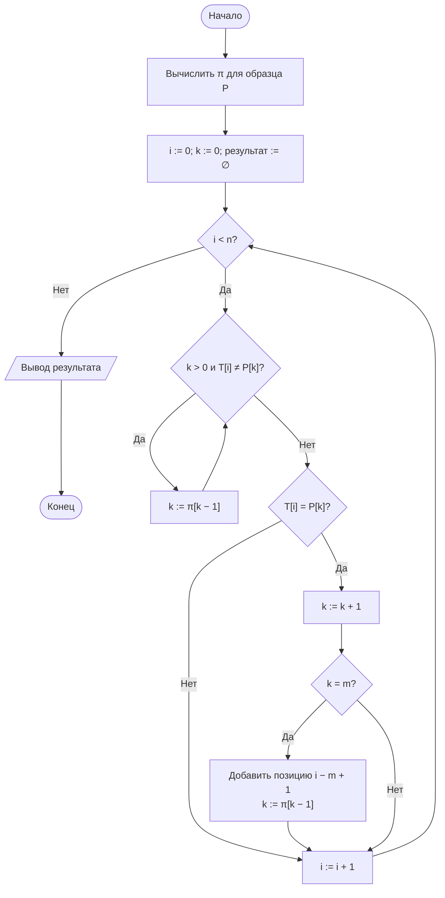

# Лабораторная работа № 11. Алгоритмы поиска подстроки и вычисления редакционного расстояния

**Дисциплина:** Теория алгоритмов  
**Направление подготовки:** 38.03.05 «Бизнес-информатика»  
**Выполнила:** Кугушева Арина, группа БИ2-1  
**Вариант:** 13

| Файл | Назначение |
|---|---|
| `README.md` | описание работы, результаты и выводы (этот файл) |
| `lab11_variant13.py` | программа: наивный поиск, КМП, расстояние Левенштейна, сопоставление записей, блокирование кандидатов |
| `report_lab11_variant13.pdf` | отчёт с титульным листом, схемами, листингом, таблицами и графиками |
---

## 1. Цель работы и задание варианта

**Цель работы:** изучить алгоритмы обработки текстовых данных — точный поиск подстроки и оценку близости строк — и применить их к задаче сопоставления наименований контрагентов при наличии опечаток.

| Параметр | Значение |
|---|---|
| Образец для ручного расчёта $\pi$ | `abcaabc` |
| Тип текста | случайный (алфавит `abcd`) |
| Длины текста $n$ | $10^4$; $5\cdot10^4$; $10^5$ |
| Порог сходства | 0,80 |
| Дополнительное задание | Л6 — блокирование кандидатов (по первой букве и по длине строки), измерение сокращения числа сравнений |

Для наглядности худшего случая выполнен также справочный эксперимент на тексте из символов `a` с образцом `a`×50 + `b` (в варианте не требуется).

## 2. Описание алгоритмов и сложность

| Алгоритм | Предобработка | Поиск | Худший случай |
|---|---|---|---|
| Наивный | нет | $\Theta((n-m+1)m)$ | $\Theta(nm)$ |
| Кнута — Морриса — Пратта | $\Theta(m)$ | $\Theta(n)$ | $\Theta(n+m)$ |
| Расстояние Левенштейна (таблица) | — | $\Theta(nm)$ времени и памяти | — |
| Расстояние Левенштейна (две строки) | — | $\Theta(nm)$ времени, $\Theta(\min(n,m))$ памяти | — |

**Префикс-функция** $\pi[i]$ — длина наибольшего собственного префикса подстроки $P[0..i]$, совпадающего с её суффиксом. **Расстояние Левенштейна:** $D[i][j]=\min(D[i-1][j]+1,\ D[i][j-1]+1,\ D[i-1][j-1]+c_{ij})$, $D[i][0]=i$, $D[0][j]=j$. **Мера сходства:** $\text{sim}(A,B)=1-d(A,B)/\max(|A|,|B|)$.

### Блок-схема алгоритма КМП



## 3. Ручной расчёт префикс-функции для образца «abcaabc»

| $i$ | Префикс | Пояснение | $\pi[i]$ |
|---|---|---|---|
| 0 | a | первый символ: собственных префиксов нет | 0 |
| 1 | ab | «ab»: префикс «a» ≠ суффикс «b» | 0 |
| 2 | abc | «abc»: префиксы «a», «ab» не равны суффиксам «c», «bc» | 0 |
| 3 | abca | «abca»: префикс «a» равен суффиксу «a» | 1 |
| 4 | abcaa | «abcaa»: пробуем продлить префикс «a» символом «a»; P[1] = «b» ≠ «a», откат k = π[0] = 0; P[0] = «a» = «a», поэтому π = 1 | 1 |
| 5 | abcaab | «abcaab»: префикс «a» продлевается символом «b» (P[1] = «b») — получаем «ab» | 2 |
| 6 | abcaabc | «abcaabc»: префикс «ab» продлевается символом «c» (P[2] = «c») — получаем «abc» | 3 |

| $i$ | 0 | 1 | 2 | 3 | 4 | 5 | 6 |
|---|---|---|---|---|---|---|---|
| $P[i]$ | a | b | c | a | a | b | c |
| $\pi[i]$ | 0 | 0 | 0 | 1 | 1 | 2 | 3 |

**Смысл.** Если совпали 6 символов «abcaab» и седьмой не совпал, то последние два символа «ab» совпадают с началом образца ($\pi[5]=2$), и сравнение продолжается с третьего символа образца без возврата по тексту. Результат программы $[0,0,0,1,1,2,3]$ совпал с ручным расчётом.

## 4. Фрагмент таблицы редакционного расстояния

Пара «кошка» → «ложка», $d=2$, сходство 0,600. Жирным выделены клетки оптимального пути:

| | ∅ | л | о | ж | к | а |
|---|---|---|---|---|---|---|
| **∅** | **0** | 1 | 2 | 3 | 4 | 5 |
| **к** | 1 | **1** | 2 | 3 | 3 | 4 |
| **о** | 2 | 2 | **1** | 2 | 3 | 4 |
| **ш** | 3 | 3 | 2 | **2** | 3 | 4 |
| **к** | 4 | 4 | 3 | 3 | **2** | 3 |
| **а** | 5 | 5 | 4 | 4 | 3 | **2** |

Операции (обратный проход): замена (к→л), совпадение «о», замена (ш→ж), совпадение «к», совпадение «а».

| Пара | $d$ | Сходство |
|---|---|---|
| «кошка» — «ложка» | 2 | 0,600 |
| «кот» — «скот» | 1 | 0,750 |
| «Ромашка» — «Ромашки» | 1 | 0,857 |
| «аналитика» — «аналитик» | 1 | 0,889 |

## 5. Листинг программы

Полный текст — в файле [`lab11_variant13.py`](lab11_variant13.py) и в PDF-отчёте. Основные функции: `naive_search`, `prefix_function`, `kmp_search`, `levenshtein`, `levenshtein_table`, `edit_path`, `similarity`, `normalize`, `match_records` (режимы блокирования `none`, `length`, `first`, `both`), `make_pool`.

```bash
python lab11_variant13.py                       # проверка, замеры и таблицы
python lab11_variant13.py --plots plots         # + графики (нужен matplotlib)
python lab11_variant13.py --json results.json   # + результаты в JSON
```

Полный запуск занимает около 40 секунд. Время зависит от компьютера, соотношения между алгоритмами и порядок роста — нет.

## 6. Результаты измерений: поиск подстроки

Среда: Linux, Python 3.13.18. Время — медиана из 5 запусков при отключённом сборщике мусора; случайный текст — алфавит `abcd`, seed = 42, образец `abcaabc`. Позиции, найденные обоими алгоритмами, сверяются с эталоном (регулярное выражение с опережающей проверкой).

**Таблица 1. Сравнение наивного поиска и КМП**

| $n$ | Текст | Наивный, с | КМП, с | Сравнений (наивный) | Сравнений (КМП) | Вхождений |
|---|---|---|---|---|---|---|
| 10 000 | случайный | 0,0012 | 0,0010 | 13 374 | 12 493 | 1 |
| 10 000 | с повторами * | 0,0326 | 0,0016 | 507 450 | 19 950 | 0 |
| 50 000 | случайный | 0,0061 | 0,0048 | 66 597 | 62 467 | 2 |
| 50 000 | с повторами * | 0,1652 | 0,0076 | 2 547 450 | 99 950 | 0 |
| 100 000 | случайный | 0,0119 | 0,0100 | 133 388 | 125 014 | 3 |
| 100 000 | с повторами * | 0,3240 | 0,0157 | 5 097 450 | 199 950 | 0 |

\* справочный эксперимент: текст из `a`, образец `a`×50 + `b` (вариантом не требуется).

Графики — в PDF-отчёте (рис. 2–3).

## 7. Сопоставление записей

Нормализация: нижний регистр, замена «ё» на «е», удаление кавычек и знаков препинания, удаление организационно-правовых форм (ООО, ОАО, ЗАО, ПАО, АО, ИП), сжатие пробелов. Затем точное сравнение через хеш-таблицу и нечёткое по расстоянию Левенштейна с порогом 0,80.

**Таблица 2. Сопоставление наименований контрагентов (порог 0,80)**

| Система А | Система Б | Сходство | Тип сопоставления |
|---|---|---|---|
| ООО "Ромашка" | Ромашка, ООО | 1,000 | точное (после нормализации) |
| АО Василёк | ВАСИЛЕК АО | 1,000 | точное (после нормализации) |
| ИП Иванов И.И. | — | 0,500 | не найдено |
| ООО «Северный ветер» | Северный Ветер ООО | 1,000 | точное (после нормализации) |
| ПАО Гранит | — | 0,500 | не найдено |
| ООО "Альфа-Строй" | Альфа Строй ООО | 0,909 | нечёткое |
| ЗАО Технопарк | Технопарк, ЗАО | 1,000 | точное (после нормализации) |
| ООО «Меридиан» | Меридан ООО | 0,875 | нечёткое |
| АО "Прогресс-Тех" | Прогресс Тех АО | 0,917 | нечёткое |
| ООО Вектор | Вектр ООО | 0,833 | нечёткое |

Итого: точных — 4, нечётких — 4, не найдено — 2.

## 8. Дополнительное задание Л6: блокирование кандидатов

Для оценки эффекта сгенерированы две «системы» по N записей (названия из 20 прилагательных и 50 существительных, форма собственности и оформление различаются, у половины наименований в системе Б опечатка в 1–2 символа, у 10 % из них — в первой букве). Соответствие записей известно, поэтому можно посчитать число найденных и верных пар. Точное сравнение выполняется первым; блокирование применяется только к нечёткому этапу.

Правила блокирования:

- **по длине** — сравниваются только строки с $|l_A-l_B|\le(1-t)\max(l_A,l_B)$; при $\text{sim}\ge t$ другие пары не могут пройти порог, поэтому правило **не теряет пар**;
- **по первой букве** — сравниваются только нормализованные имена с одинаковой первой буквой; правило приближённое;
- **по обоим признакам** — оба условия сразу.

**Таблица 3. Число сравнений (вызовов similarity), время и результат**

| $N$ | Режим | Сравнений | Сокращение | Время, с | Найдено пар | Верных | Совпадает с полным |
|---|---|---|---|---|---|---|---|
| 200 | без блокирования | 10 404 | ×1,00 | 0,302 | 200 | 200 | да |
| 200 | по длине | 7 970 | ×1,31 | 0,234 | 200 | 200 | да |
| 200 | по первой букве | 987 | ×10,54 | 0,030 | 178 | 178 | нет |
| 200 | по длине и первой букве | 770 | ×13,51 | 0,025 | 178 | 178 | нет |
| 400 | без блокирования | 45 369 | ×1,00 | 1,359 | 400 | 400 | да |
| 400 | по длине | 32 082 | ×1,41 | 1,115 | 400 | 400 | да |
| 400 | по первой букве | 4 901 | ×9,26 | 0,155 | 362 | 361 | нет |
| 400 | по длине и первой букве | 3 563 | ×12,73 | 0,118 | 362 | 361 | нет |
| 800 | без блокирования | 152 881 | ×1,00 | 4,727 | 800 | 800 | да |
| 800 | по длине | 108 123 | ×1,41 | 3,706 | 800 | 800 | да |
| 800 | по первой букве | 15 901 | ×9,61 | 0,513 | 749 | 747 | нет |
| 800 | по длине и первой букве | 11 881 | ×12,87 | 0,401 | 749 | 747 | нет |

График — в PDF-отчёте (рис. 4).

## 9. Выводы

1. На случайном тексте (алфавит из 4 букв, образец «abcaabc») наивный поиск и КМП практически не различаются: при n = 10^5 время 0,0119 с и 0,0100 с, число сравнений 133 388 и 125 014, то есть около 1,33n и 1,25n. Несовпадение на случайных данных обнаруживается на первых символах, поэтому реальная трудоёмкость наивного алгоритма близка к Θ(n). Выигрыш КМП по числу сравнений составляет всего 6 %, а по времени в Python КМП немного быстрее.
2. Рост времени на случайном тексте линейный: при увеличении n в 10 раз (10^4 → 10^5) время наивного алгоритма растёт в 9,8 раза, КМП — в 10,3 раза. В тексте встретилось 1, 2 и 3 вхождений образца; позиции обоих алгоритмов совпали с эталоном (регулярное выражение).
3. На «неудобном» тексте с повторами (справочный эксперимент) различие принципиально: при n = 10^5 наивный алгоритм выполняет 5 097 450 сравнений против 199 950 у КМП (25,5 раза), по времени — 0,324 с против 0,016 с (20,6 раза). Это подтверждает Θ(nm) у наивного алгоритма и Θ(n + m) у КМП.
4. Префикс-функция образца «abcaabc» равна [0, 0, 0, 1, 1, 2, 3]; ручной расчёт совпал с программой. Особенность образца — откат на шаге i = 4: после совпадения «abca» символ «a» не продолжает префикс «ab», и значение определяется через π[0] = 0.
5. Расстояние Левенштейна корректно улавливает опечатки: d(«кошка», «ложка») = 2 (две замены), d(«Ромашка», «Ромашки») = 1 при сходстве 0,857. Обратный проход по таблице восстанавливает последовательность операций.
6. Сопоставление 10 наименований контрагентов при пороге 0,80: 4 пар найдено точно после нормализации, 4 — нечётко (опечатки «Меридан», «Вектр», разница в дефисе «Альфа-Строй» и «Альфа Строй»), 2 не найдены. Отказ для «Иванов И.И.» / «Иванов Иван Иванович» и «Гранит» / «Гранит-Строй» оправдан: в первом случае различается форма записи имени, во втором это разные организации.
7. Л6. Сравнение «каждый с каждым» требует |A|·|B| вызовов расстояния Левенштейна. При N = 800 записей (после точного этапа остаётся 391 неточных) это 152 881 вызовов и 4,73 с. Блокирование по длине не теряет пар (при sim ≥ 0,8 длины могут различаться не более чем на 20 %) и сокращает число сравнений в 1,41 раза; блокирование по первой букве сокращает в 9,6 раза, по обоим признакам — в 12,9 раза (11 881 вызовов, 0,40 с против 4,73 с).
8. Цена блокирования по первой букве — потери: найдено 749 пар из 800, так как опечатка в первой букве переводит запись в другой блок (при N = 200 — 178 из 200). Блокирование по длине безопасно, по первой букве — приближённое: оно подходит, когда ошибки в начале слова редки, либо нужно комбинировать несколько блоков (например, первая и последняя буква, фонетический код).
9. Выбор метода: для поиска подстроки в случайных текстах достаточно наивного алгоритма или встроенного str.find, для текстов с повторами и гарантированной линейной оценкой нужен КМП; для нечёткого сопоставления больших справочников обязательны нормализация, точное сравнение через хеш-таблицу и блокирование кандидатов.
